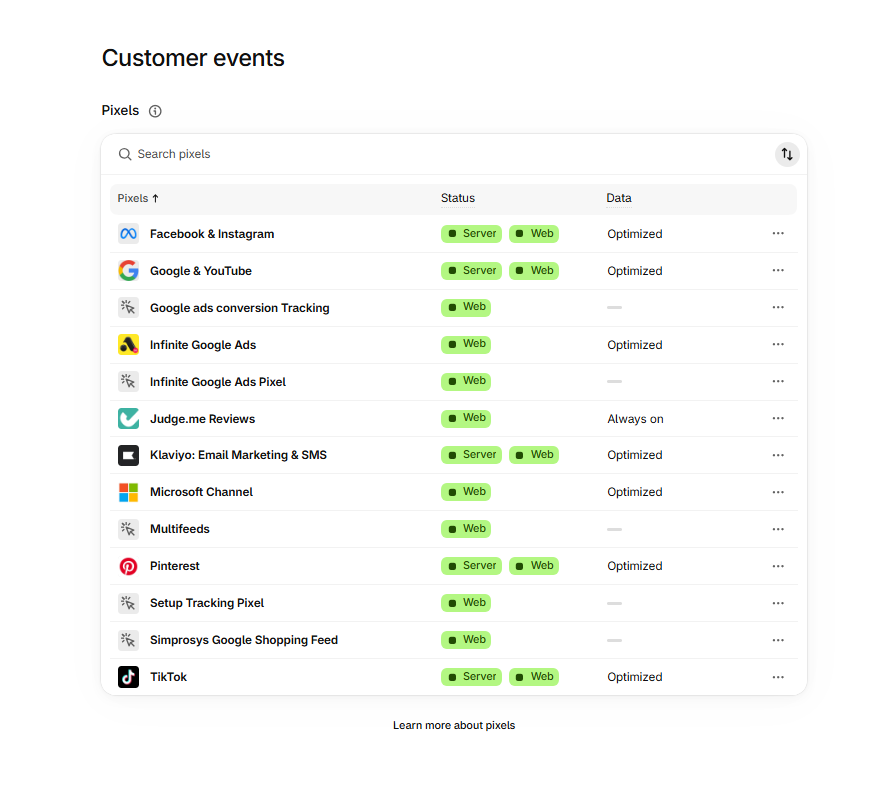
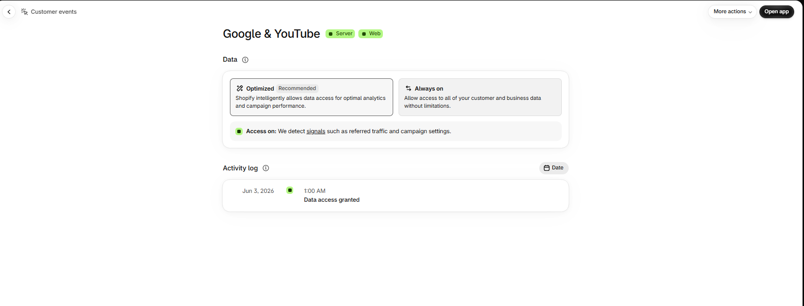
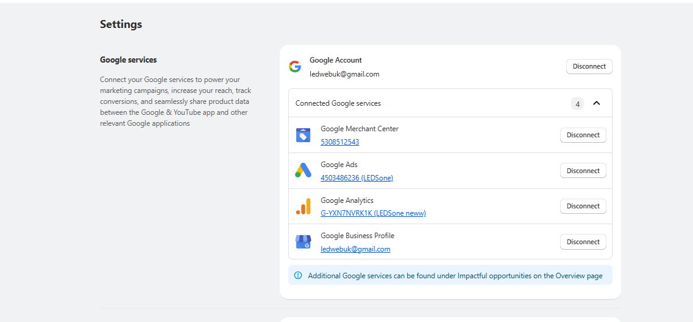
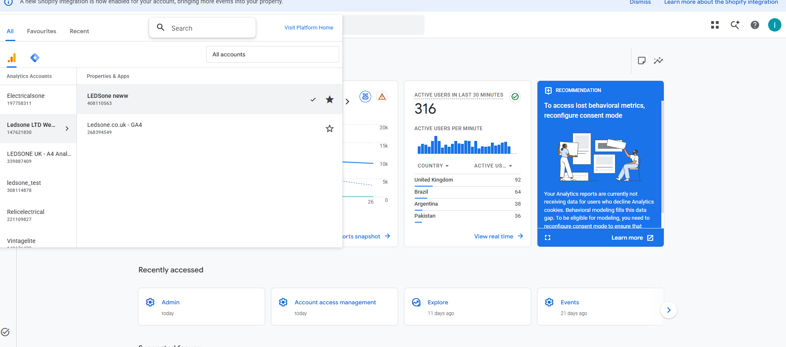
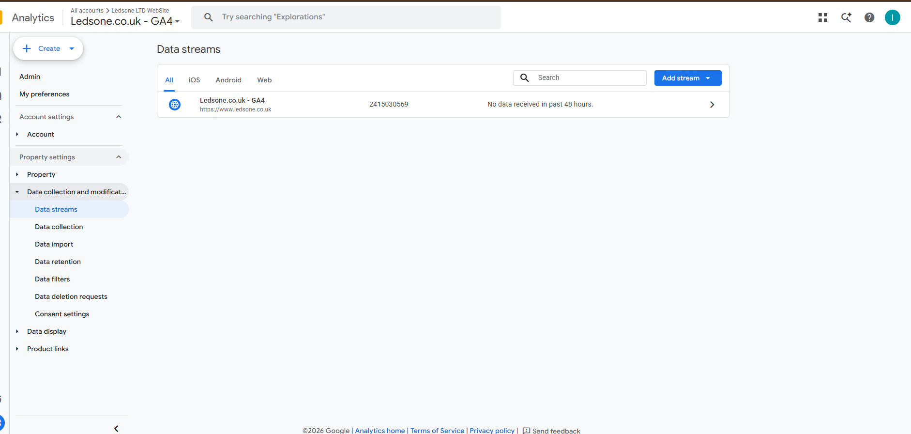
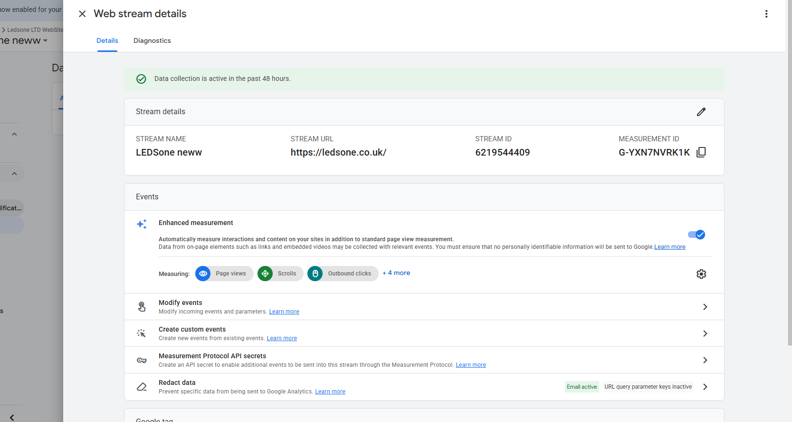
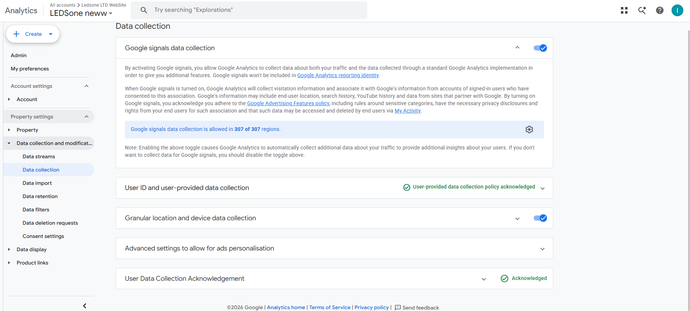
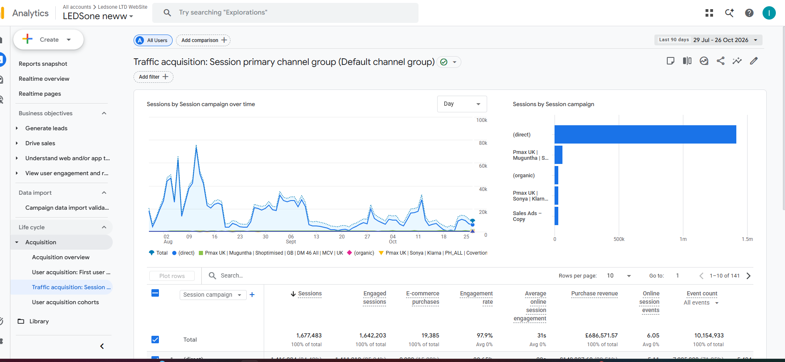
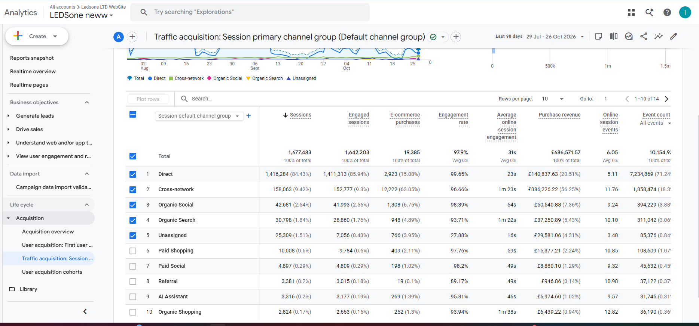

# C5 — Fix GA4 Purchase Tracking on ledsone.co.uk
**Task ID:** BP-unknown
**Priority:** YELLOW - TASK
**Date:** 2026-10-27
**Due:** Fri 30 Oct
**Status:** 50% — Investigation complete, fix pending

---

## Task Description
GA4 property 408110563 records 2,043 organic sessions over 90 days while Search Console shows ~1,500–1,700 organic clicks weekly. Verify measurement ID and confirm purchase events include Shopify order number.

---

## Step 1 — Shopify Customer Events (Pixel Audit)

Checked Settings → Customer Events. Found 5 Google-related pixels active simultaneously — this is a risk for duplicate or conflicting data.

**Pixels found:**
- Google & YouTube (Server + Web) ✓
- Google ads conversion Tracking (Web only)
- Infinite Google Ads (Web only)
- Infinite Google Ads Pixel (Web only)
- Setup Tracking Pixel (Web only)

**Risk:** Multiple Google pixels can cause session inflation and duplicate conversion counts.

---

## Step 2 — Google & YouTube Pixel Detail

Clicked into Google & YouTube pixel. Data access was granted June 2026. No Measurement ID visible here — need to open the app.

---

## Step 3 — Measurement ID Confirmed

Opened the Google & YouTube app. Found the connected GA4 property:

**Connected:**
- Google Analytics: `G-YXN7NVRK1K` (LEDSone neww)
- Google Ads: 4503486236 (LEDSone)
- Google Merchant Center: 5308512543
- Account: ledwebuk@gmail.com

---

## Step 4 — GA4 Property List Audit

Opened GA4. Found multiple properties under Ledsone LTD WebSite account.

| Property | ID | Status |
|---|---|---|
| LEDSone neww | 408110563 | Active — Shopify connected ✓ |
| Ledsone.co.uk - GA4 | 268394549 | No data |
| LEDSONE UK - A4 Anal... | 339887409 | Unknown |
| ledsone_test | 308114878 | Test |
| Electricalsone | 197758311 | Separate site |

---

## Step 5 — Wrong Property Check (268394549)

Checked "Ledsone.co.uk - GA4" (268394549) — the one that looked like it should be the real property.

**Finding:** "No data received in past 48 hours" — this property is NOT connected to anything. Can be ignored.

---

## Step 6 — LEDSone neww Stream Confirmed Active

Checked the stream details for LEDSone neww (408110563).

**Confirmed:**
- Stream URL: `https://ledsone.co.uk/` ✓
- Measurement ID: `G-YXN7NVRK1K` ✓
- Status: **Data collection is active in the past 48 hours** ✓
- Enhanced measurement: ON (Page views, Scrolls, Outbound clicks + 4 more)

**Conclusion:** Shopify is connected to the correct property. Measurement ID is correct.

---

## Step 7 — Consent Settings Check

Checked Admin → Data collection → Consent settings.

**Result: Excellent**
- Behavioural analytics consent signals: **Active** ✓
- Advertising consent signals: **Active** ✓
- No issues detected

**Consent mode is NOT the cause of the data gap.**

---

## Step 8 — Traffic Acquisition (Session Campaign View)

Opened Reports → Acquisition → Traffic acquisition. Initial view showed Session campaign — organic fragmented across campaigns.

Switched dimension to Session default channel group for accurate channel breakdown.

---

## Step 9 — Root Cause Found (Default Channel Group)

Switched to Session default channel group — full 90-day breakdown revealed the real problem.

**Last 90 days (29 Jul – 26 Oct 2026):**

| Channel | Sessions | % | Purchases | Revenue |
|---|---|---|---|---|
| **Direct** | **1,416,284** | **84.43%** | 2,923 | £140,837.63 |
| Cross-network | 158,063 | 9.42% | 12,222 | £386,226.22 |
| Organic Social | 42,681 | 2.54% | 1,308 | £50,540.88 |
| **Organic Search** | **30,798** | **1.84%** | **948** | **£37,250.89** |
| Unassigned | 25,309 | 1.51% | 766 | £29,581.06 |
| Paid Shopping | 10,008 | 0.60% | 409 | £15,377.21 |
| **Total** | **1,677,483** | 100% | **19,385** | **£686,571.57** |

**84.43% Direct is abnormal.** Normal e-commerce benchmark is 20–30% Direct. This means organic (and other) sessions are losing referrer data and being attributed as Direct.

---

## Root Cause Summary

**Referrer data is being lost before GA4 receives it.**

Most likely cause: redirect chains (e.g. `ledsone.co.uk` → `www.ledsone.co.uk`) strip the HTTP referrer header. GA4 sees no source/medium and defaults to Direct.

**What IS working:**
- GA4 connected and active ✓
- Correct measurement ID ✓
- Purchase events firing (948 purchases, £37k organic revenue) ✓
- Consent mode configured correctly ✓

---

## Next Steps

| Priority | Action |
|---|---|
| HIGH | Test redirect chain — does ledsone.co.uk redirect to www? Does referrer survive? |
| HIGH | GA4 DebugView — open incognito, click Google result, check source/medium recorded |
| MEDIUM | Review 5 simultaneous Google pixels — check for session inflation |
| MEDIUM | UTM tag internal links to recover 25k Unassigned sessions |
